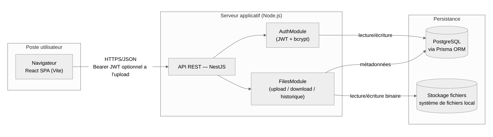
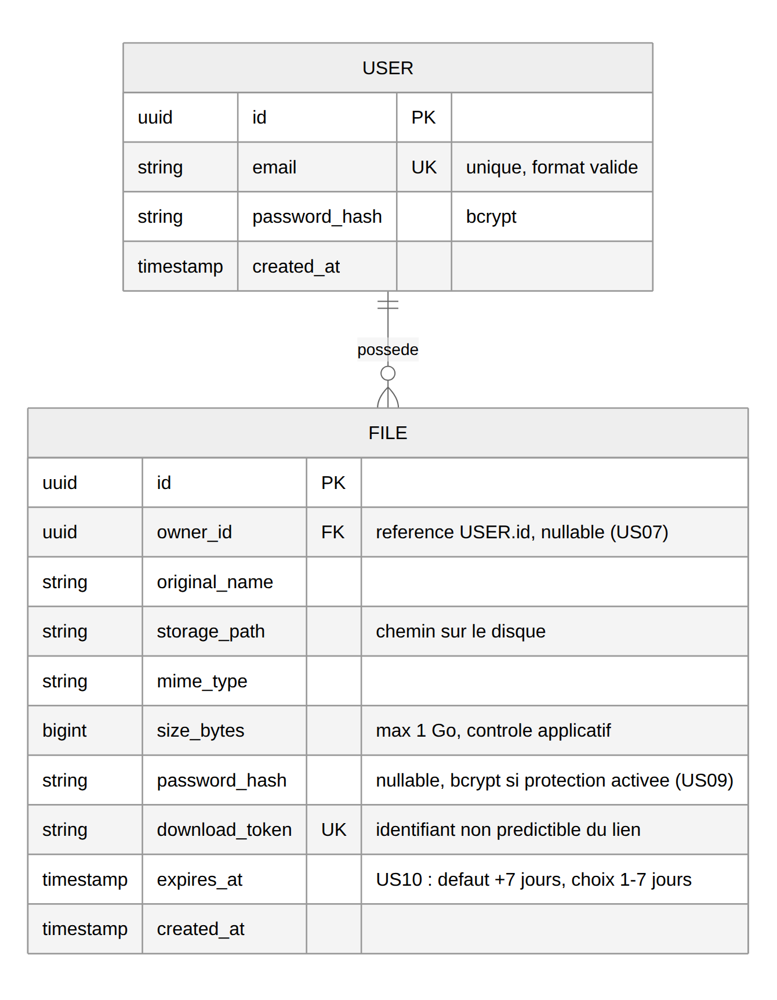
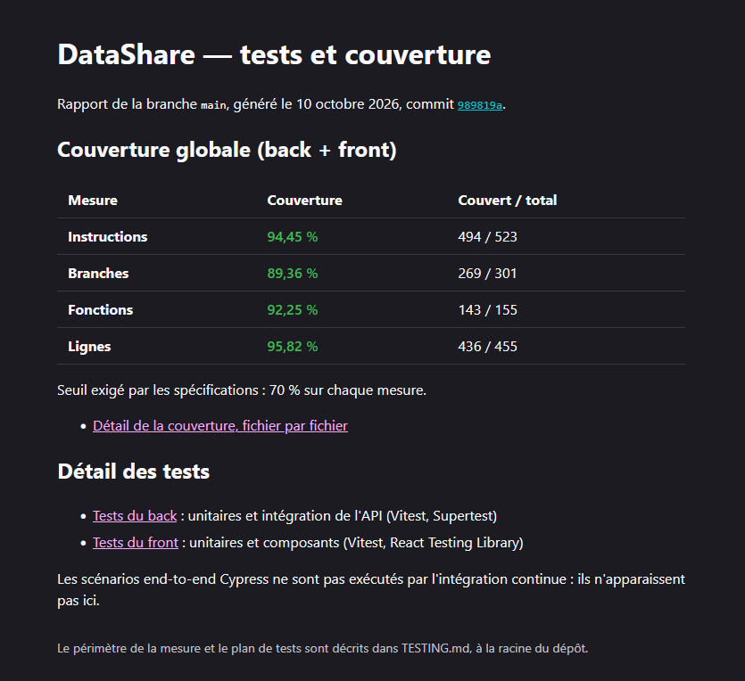
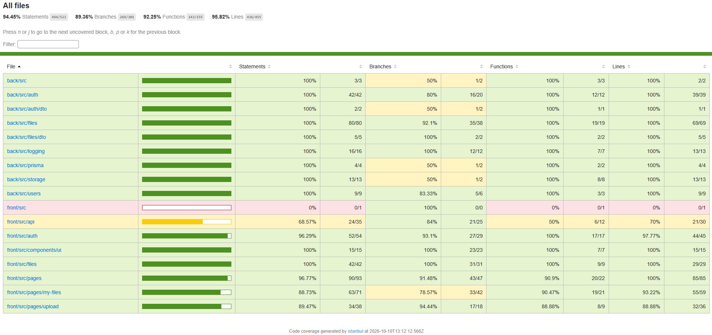
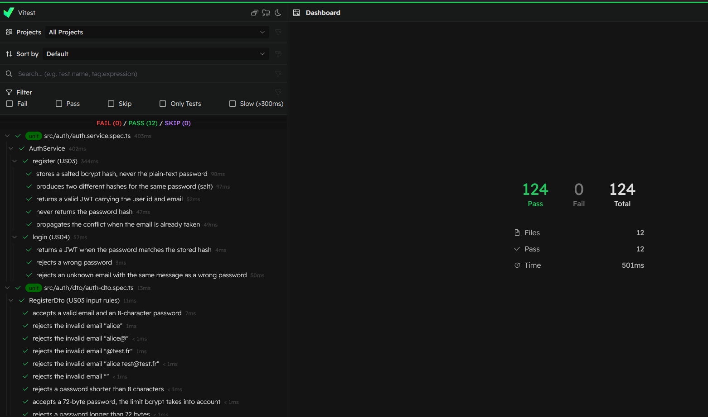
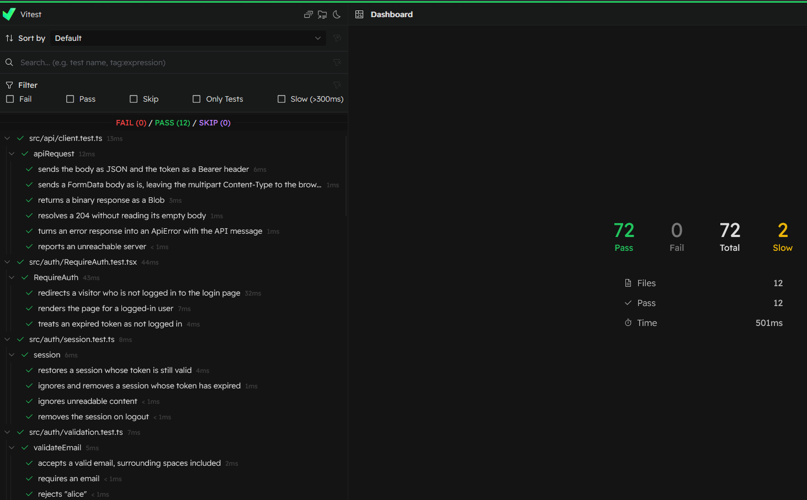
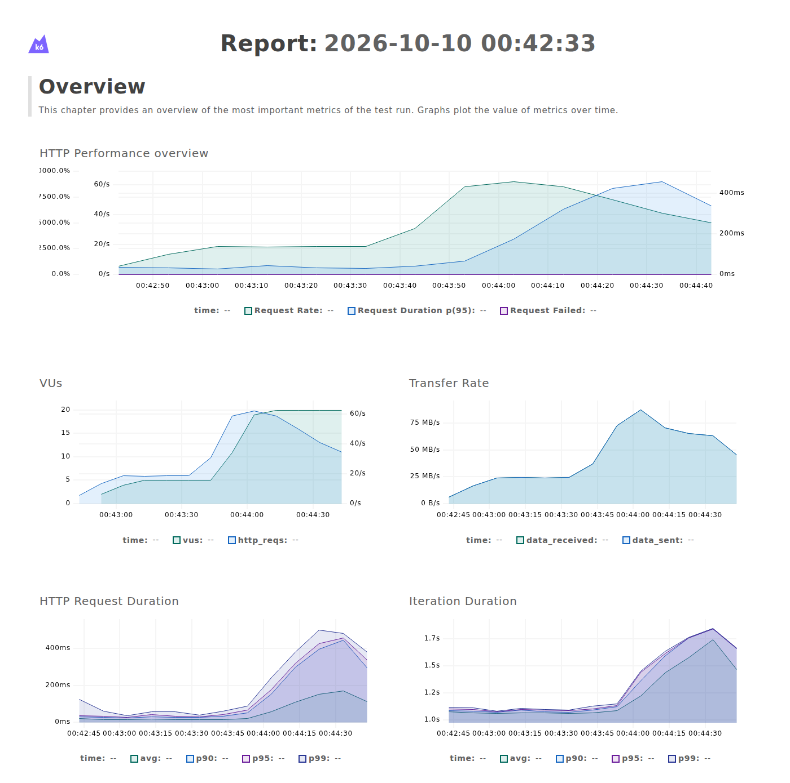

# DataShare — Documentation technique

DataShare est un prototype de partage de fichiers : un utilisateur dépose un fichier, reçoit un lien de téléchargement temporaire et le transmet à qui il veut. Ce document suit le plan du modèle de documentation technique fourni. Il résume chaque sujet et renvoie vers le fichier du dépôt qui le détaille.

| Section | Détail dans le dépôt |
|---|---|
| 1. Architecture de l'application | [architecture.md](architecture.md), « Schéma d'architecture » |
| 2. Choix technologiques justifiés | [architecture.md](architecture.md), « Choix technologiques justifiés » |
| 3. Modèle de données | [mcd.md](mcd.md), `back/prisma/schema.prisma` |
| 4. Documentation d'API | [api-contract.yaml](api-contract.yaml) |
| 5. Sécurité et gestion des accès | [SECURITY.md](SECURITY.md) |
| 6. Qualité, tests et maintenance | [TESTING.md](TESTING.md), [SECURITY.md](SECURITY.md), [PERF.md](PERF.md), [MAINTENANCE.md](MAINTENANCE.md) |
| 7. Processus d'installation et d'exécution | [README.md](../README.md) |
| 8. Utilisation de l'IA dans le développement | [ia.md](ia.md) |

**Périmètre livré.** Le MVP complet (US01 à US06) et, parmi les fonctionnalités avancées optionnelles, l'upload anonyme (US07), le mot de passe de fichier (US09) et le choix de la durée d'expiration (US10). Ne sont pas réalisées : la gestion des tags (US08) et la purge quotidienne des fichiers expirés (US10). Un lien expiré est refusé, mais le fichier reste stocké.

## 1. Architecture de l'application



L'application comporte quatre briques :

| Brique | Rôle | Échanges |
|---|---|---|
| Navigateur — React (Vite) | Interface : upload, téléchargement par lien, connexion, espace « Mes fichiers » | Appelle l'API en HTTPS/JSON ; envoie le JWT dans l'en-tête `Authorization: Bearer` quand l'utilisateur est connecté |
| API REST — NestJS | Point d'entrée unique, en deux modules : `AuthModule` (inscription, connexion) et `FilesModule` (upload, téléchargement, historique, suppression) | Lit et écrit les métadonnées en base, le contenu des fichiers dans le stockage |
| PostgreSQL (via Prisma) | Utilisateurs et métadonnées des fichiers | Conteneur Docker (`docker-compose.yml`) |
| Stockage des fichiers | Contenu binaire, sur le disque du serveur | Isolé derrière `StorageService`, pour pouvoir passer à S3 sans toucher au reste |

Le navigateur ne s'adresse qu'à une seule origine, en HTTPS : elle sert le front et transmet à l'API les appels préfixés par `/api`. En développement, le serveur Vite joue ce rôle de proxy. En production, il reviendrait à un reverse proxy, qui reste à mettre en place : le prototype n'a pas d'environnement d'hébergement.

### Organisation du front

Le front est découpé par responsabilité, dans `front/src/` :

| Dossier | Rôle |
|---|---|
| `pages/` | Un écran par route : accueil (upload), connexion, inscription, téléchargement (`/f/:token`), espace personnel (`/mon-espace`) |
| `components/ui/` | Composants réutilisables : `Button`, `Input`, `Callout`, `Card`, `Header`, `PublicLayout`, `FileInfo`. Un élément n'y entre que s'il sert à au moins deux écrans |
| `api/` | Service d'accès à l'API : point d'entrée unique (`apiRequest`), les écrans n'appellent jamais `fetch` directement |
| `auth/` | Session de l'utilisateur (Context React, conservée dans le `localStorage`) et garde des routes protégées (`RequireAuth`) |
| `files/` | Règles de saisie et mise en forme des fichiers (taille, dates) |

- **Gestion d'état.** Le seul état partagé entre les écrans est la session (token JWT et utilisateur), portée par un Context React. Le reste est de l'état serveur : chaque écran le demande à l'API quand il en a besoin. Une librairie de gestion d'état (Redux) n'apporterait rien à ce périmètre.
- **Erreurs.** Toute réponse en erreur de l'API devient une `ApiError`, qui porte le code HTTP et un message déjà lisible. L'écran l'affiche tel quel, sous le champ concerné ou dans un bandeau annoncé aux lecteurs d'écran (`role="alert"`). Une panne réseau donne un message dédié.
- **Responsive.** Les styles sont écrits d'abord pour le mobile, puis adaptés à partir de 768 px de large.
- **Accessibilité.** Champs reliés à leur libellé et à leur message d'erreur (`label`, `aria-describedby`, `aria-invalid`), boutons d'icône nommés (`aria-label`), filtre de l'espace personnel en `fieldset`, l'élément natif pour un groupe de contrôles. Lighthouse donne 100 en accessibilité sur l'accueil et 92 sur la connexion, où le contraste de deux éléments repris des maquettes reste à corriger.

La légende complète du schéma, le détail des flux et les arbitrages du front sont dans [architecture.md](architecture.md).

## 2. Choix technologiques justifiés

Le critère principal est le délai : un développeur seul, quatre semaines, un MVP complet.

| Élément | Choix | Alternatives | Raison principale |
|---|---|---|---|
| Langage | TypeScript, front et back | Java, C#, PHP | Un seul langage sur toute la pile ; le typage sécurise le contrat entre le front et l'API |
| Back-end | NestJS | Spring Boot, .NET Core, Symfony | Architecture modulaire (modules, guards, pipes), validation et upload intégrés |
| Front-end | React + Vite | Angular, Vue | Écosystème large, démarrage et rechargement rapides |
| Base de données | PostgreSQL | MongoDB | Données relationnelles, contraintes d'unicité garanties par le moteur |
| ORM | Prisma | TypeORM, Sequelize | Un schéma déclaratif qui sert aux migrations et documente le modèle |
| Authentification | JWT + bcrypt, via Passport | Sessions serveur, OAuth2 | Sans état côté serveur, suffisant pour le périmètre |
| Stockage | Système de fichiers local | AWS S3 | Ni dépendance ni coût cloud pour un prototype |
| Tests | Vitest, React Testing Library, Supertest, Cypress | Jest, Playwright | Vitest est commun au front et au back ; Cypress pilote un vrai navigateur pour les parcours de bout en bout |
| Qualité et CI | oxlint, Prettier, hooks Git natifs, GitHub Actions | ESLint, Husky | Contrôles rapides, sans dépendance supplémentaire |
| Audit des dépendances | `npm audit` | Snyk, Dependabot | Natif à npm, sans outil à installer ; bloque le push sur une vulnérabilité haute ou critique |
| Scan de sécurité | Trivy (image Docker) | Snyk, OSV-Scanner | Couvre ce que `npm audit` ne voit pas : images Docker (PostgreSQL), secrets commités par erreur, fichiers d'infrastructure. Permet de documenter une vulnérabilité acceptée, ce que `npm audit` ne sait pas faire. Même commande en local et en CI, sans installation ni compte |
| Test de charge | k6 (image Docker) | Artillery, JMeter | Scénario en JavaScript, comme le reste de la pile, qui rejoue un partage complet. Ses seuils (taux d'erreur, latence au 95e centile) font échouer le test : la performance devient un critère vérifiable, pas une impression. Montre aussi où l'API sature |
| Performance du front | Lighthouse (lancé à la demande) | Mesure manuelle dans les DevTools | Référence pour les Core Web Vitals (LCP, TBT, CLS). Chiffre le budget de performance du navigateur, sur un profil mobile reproductible ; relève aussi les défauts d'accessibilité. Aucune dépendance ajoutée au projet |
| Logs | pino (`nestjs-pino`) | Winston, logger de Nest | Une ligne JSON par requête avec sa durée et un identifiant de corrélation ; fournit les métriques du suivi de performance |

Le dépôt est un monorepo npm workspaces : `back/`, `front/` et `shared_lib/`. Ce dernier package contient les types de l'API, les constantes et les messages de validation, utilisés par le front et le back pour que les deux côtés appliquent les mêmes règles.

Le tableau complet et les arbitrages (pas de Redux, pas de librairie de composants, codes d'erreur HTTP, HTTPS en développement…) sont dans [architecture.md](architecture.md).

## 3. Modèle de données

Deux entités, liées par une relation 1-N :



- **USER** : identifiant, email unique, hash bcrypt du mot de passe, date de création.
- **FILE** : nom d'origine, chemin de stockage, type, taille, date d'expiration, token de téléchargement unique, hash optionnel du mot de passe de protection, propriétaire.

Le propriétaire d'un fichier est facultatif : il est vide pour un upload anonyme (US07). Le lien de téléchargement repose sur un token aléatoire, distinct de l'identifiant technique du fichier.

Les règles de gestion et les index sont dans [mcd.md](mcd.md). Le schéma appliqué à la base est `back/prisma/schema.prisma`.

## 4. Documentation d'API

Le contrat d'interface entre le front et l'API est une spécification OpenAPI 3 : [api-contract.yaml](api-contract.yaml). Elle s'ouvre dans tout éditeur OpenAPI (Swagger Editor, extension OpenAPI de VS Code).

| Route | Rôle | Accès |
|---|---|---|
| `POST /auth/register` | Créer un compte (US03) | Public |
| `POST /auth/login` | Se connecter, obtenir un JWT (US04) | Public |
| `GET /auth/me` | Renvoie l'identité associée au token. Route témoin du contrôle d'accès par JWT : elle sert aux tests d'intégration et permet à un client de vérifier que son token est encore accepté. Le front ne l'appelle pas, il lit l'utilisateur dans la réponse de connexion | Connecté |
| `POST /files` | Téléverser un fichier (US01, US07) | Public ; rattaché au compte si un token est fourni |
| `GET /files` | Historique de ses fichiers (US05) | Connecté |
| `DELETE /files/{id}` | Supprimer un de ses fichiers (US06) | Connecté, propriétaire |
| `GET /f/{token}` | Métadonnées d'un fichier partagé | Public |
| `POST /f/{token}/download` | Télécharger le fichier (US02) | Public ; mot de passe si le fichier est protégé |

Convention d'erreurs : `422` pour tout contrôle de saisie non respecté, `400` pour une requête illisible, `401` sans authentification valide, `403` pour le fichier d'autrui, `404` pour une ressource inconnue, `410` pour un lien expiré. Chaque erreur porte un message lisible par l'utilisateur.

## 5. Sécurité et gestion des accès

### Authentification

- **JWT signé**, émis à l'inscription et à la connexion, envoyé par le front dans l'en-tête `Authorization: Bearer`. Sa durée de vie est limitée (`JWT_EXPIRES_IN`, un jour par défaut). Il n'y a pas de token de rafraîchissement : l'utilisateur se reconnecte à l'expiration.
- **Mots de passe hashés et salés** avec bcrypt, pour les comptes comme pour les fichiers protégés. Ils ne sont jamais stockés en clair, renvoyés ni journalisés.
- **Même réponse** (message et temps de réponse) pour un email inconnu et un mauvais mot de passe : la connexion ne révèle pas quels comptes existent.

### Permissions

L'application n'a pas de rôles : les spécifications n'en demandent pas. Les droits tiennent à trois niveaux d'accès.

| Niveau | Ce qu'il permet |
|---|---|
| Visiteur | Créer un compte, se connecter, déposer un fichier (upload anonyme), télécharger par lien |
| Utilisateur connecté | En plus : déposer des fichiers rattachés à son compte et consulter son historique |
| Propriétaire d'un fichier | Supprimer ce fichier |

- Le propriétaire est toujours déduit du token, jamais d'un paramètre de la requête. Supprimer le fichier d'un autre utilisateur renvoie `403`.
- Sur la route d'upload, l'authentification est optionnelle mais jamais ignorée : un token présenté et invalide est refusé (`401`), pas traité comme un upload anonyme.
- Un fichier anonyme n'a pas de propriétaire : il n'apparaît dans aucun historique et personne ne peut le supprimer depuis l'application.

### Mesures de protection

- **HTTPS** entre le navigateur et le proxy, dès le développement.
- **Validation côté client et côté serveur** : les règles sont définies une fois dans `shared_lib`. Le serveur fait foi (`ValidationPipe` en liste blanche, qui retire les champs non déclarés).
- **Lien non devinable** : token de téléchargement UUID v4 (122 bits aléatoires).
- **Téléchargement toujours en binaire** (`application/octet-stream`, `nosniff`) : le navigateur n'exécute jamais un fichier déposé.
- **XSS** : React échappe tout contenu affiché, et l'application n'insère jamais de HTML brut. Un fichier déposé ne peut pas s'exécuter dans le navigateur (téléchargement en binaire, ci-dessus).
- **CSRF** : le token JWT voyage dans l'en-tête `Authorization`, ajouté par le code du front, et non dans un cookie que le navigateur enverrait de lui-même. Un site tiers ne peut donc pas faire agir un utilisateur connecté à son insu. L'API n'autorise aucune autre origine (pas de CORS).
- **Injections SQL** : tous les accès à la base passent par Prisma, dont les requêtes sont paramétrées ; le code ne contient aucune requête SQL écrite à la main.
- **Logs sans donnée sensible** : champs journalisés en liste blanche, token de téléchargement tronqué, ni mot de passe ni email.
- **Dépendances surveillées** : `npm audit` et Trivy, au push et dans la CI.

### Limites et restrictions

| Limite | Valeur |
|---|---|
| Taille d'un fichier | 1 Go, reçu en flux et interrompu au dépassement |
| Extensions refusées | Exécutables et scripts (`.exe`, `.bat`, `.sh`, `.jar`…) |
| Durée de vie d'un lien | 1 à 7 jours, 7 par défaut ; lien refusé (`410`) dès l'expiration |
| Mot de passe de compte | 8 caractères au minimum |
| Mot de passe de fichier | 6 caractères au minimum |

### Risques acceptés pour le MVP

- Pas de limitation de débit : l'upload anonyme permet d'écrire jusqu'à 1 Go par requête, et la connexion n'est pas protégée contre la force brute au-delà du coût de bcrypt. C'est l'évolution prioritaire.
- Pas de purge : les fichiers expirés restent sur le disque.
- Token stocké dans le `localStorage`, donc lisible par un script injecté ; React échappe le contenu affiché, ce qui limite ce risque.
- Pas d'en-têtes de sécurité HTTP (CSP, HSTS) ni d'analyse antivirus.

Le détail des scans et des décisions est dans [SECURITY.md](SECURITY.md).

## 6. Qualité, tests et maintenance

### Tests — [TESTING.md](TESTING.md)

Quatre niveaux de test couvrent les fonctionnalités critiques : unitaire (Vitest), composant React (React Testing Library), intégration de l'API (Supertest, sur l'application complète et une base PostgreSQL de test) et end-to-end dans un navigateur (Cypress).

| Suite | Résultat au 10/10/2026 |
|---|---|
| Unitaires `shared_lib` | 10 tests réussis sur 10 |
| Unitaires back | 81 sur 81 |
| Intégration de l'API | 43 sur 43 |
| Unitaires et composants front | 72 sur 72 |
| End-to-end Cypress | 3 scénarios sur 3 : inscription, connexion, upload puis téléchargement |

Couverture globale : 95,82 % des lignes, 94,45 % des instructions, 89,36 % des branches et 92,25 % des fonctions, pour un seuil de 70 %. La commande `npm run test:cov` échoue sous ce seuil, en local comme dans la CI. Le rapport est publié en ligne à chaque push : https://negstek.github.io/3_pilotez_un_projet/

Les tests ont aussi servi à corriger : les anomalies qu'ils ont détectées, et celles que la relecture a trouvées puis que des tests verrouillent, sont listées dans la section « Anomalies détectées et corrigées » de `TESTING.md`.

Les captures suivantes viennent de ce rapport en ligne : sa page d'accueil, le détail de la couverture, puis les résultats des tests du back et du front.

[](https://negstek.github.io/3_pilotez_un_projet/)

*Page d'accueil du rapport en ligne : <https://negstek.github.io/3_pilotez_un_projet/>*







Les critères d'acceptation de chaque fonctionnalité et les instructions d'exécution sont dans `TESTING.md`.

### Sécurité — [SECURITY.md](SECURITY.md)

Le scan initial de `npm audit` relevait 9 vulnérabilités, dont 6 hautes. Toutes sont corrigées :

- 5 venaient de `@nestjs/mau`, une dépendance ajoutée d'office par le générateur de projet et inutilisée : elle a été supprimée.
- 4 arrivaient par Prisma : elles sont corrigées par deux `overrides` vers des versions saines, plutôt que par la rétrogradation de Prisma que proposait `npm audit fix --force`.

Trivy ne relève rien sur le dépôt. Sur l'image PostgreSQL, une seule exception est acceptée et documentée : le binaire `gosu`, dont les fonctions vulnérables ne sont pas atteignables.

### Performance — [PERF.md](PERF.md)

- **Test de charge k6** sur le parcours critique (upload de 5 Mo, métadonnées, téléchargement, suppression), de 5 à 20 utilisateurs simultanés : 4 309 requêtes, aucune erreur, tous les seuils respectés (upload p95\* à 447 ms pour un seuil de 2 s, téléchargement p95 à 269 ms pour un seuil de 1 s).

  \* *p95 : 95e centile, la durée sous laquelle se terminent 95 % des requêtes. Il décrit l'expérience des utilisateurs les moins bien servis, que la moyenne masque.*



- **Interprétation** : l'API est à l'aise à charge nominale. À 20 utilisateurs, le process Node unique sature : il ralentit, sans erreur. La mémoire reste bornée, ce qui confirme que les fichiers sont traités en flux.
- **Budget du front** : 87,6 Ko de JavaScript compressé pour un budget de 150 Ko ; score Lighthouse de 94 en mobile ; LCP de 2,5 s, à la limite du budget, donc l'indicateur à surveiller.
- **Métriques suivies** : les logs JSON (pino) donnent le temps de réponse par route, le taux d'erreur et la taille des fichiers transférés.
- **Optimisations possibles** : plusieurs process Node, téléchargement délégué au reverse proxy, stockage objet, limitation de débit.

### Maintenance — [MAINTENANCE.md](MAINTENANCE.md)

- **Contrôles automatiques** à trois moments : au commit (lint, formatage), au push (`npm audit`) et dans la CI (tout, plus Trivy, les tests et la couverture), à chaque push et chaque lundi.
- **Fréquence des mises à jour** : immédiate pour une vulnérabilité haute ou critique ; toutes les deux semaines pour les versions correctives et mineures ; au cas par cas, une par une, pour les versions majeures ; tous les mois pour les images Docker et les outils épinglés.
- **Risques** : régression (parade : suite de tests complète), changements incompatibles d'une version majeure (lecture du guide de migration, une majeure par commit), paquet compromis (`npm ci` sur le lockfile, scripts d'installation autorisés un par un).
- `MAINTENANCE.md` décrit aussi la procédure pas à pas, la correction d'une anomalie à partir des logs, la sauvegarde et la restauration.

## 7. Processus d'installation et d'exécution

### Prérequis

- Node.js 20.19+ ou 22.12+, et npm
- Docker et Docker Compose

### Installation

```bash
git clone https://github.com/negstek/3_pilotez_un_projet.git
cd 3_pilotez_un_projet
sh scripts/install.sh
```

Le script vérifie les prérequis, crée les fichiers `.env`, installe les dépendances, démarre PostgreSQL, applique les migrations et compile l'application. Il peut être relancé sans risque. La base seule se configure avec `npm run db:setup`.

### Lancement

```bash
# Terminal 1 — API
cd back && npm run start:dev

# Terminal 2 — front
cd front && npm run dev
```

L'application s'ouvre sur https://localhost:8080. Le certificat est auto-signé : le navigateur demande de l'accepter une fois.

### Commandes principales

| Commande (à la racine) | Effet |
|---|---|
| `npm test` | Tests unitaires des trois packages |
| `npm run e2e` | Scénarios Cypress, sur un back et un front dédiés |
| `npm run test:cov` | Couverture globale, échoue sous 70 % |
| `npm run lint` / `npm run format:check` | Lint et formatage |
| `npm run security:audit` / `npm run security:trivy` | Scans de sécurité |
| `npm run perf` | Test de charge k6 |

### Variables d'environnement

Trois fichiers `.env`, créés par le script à partir des fichiers `.env.example` et jamais commités.

| Fichier | Variable | Rôle |
|---|---|---|
| `.env` (racine) | `POSTGRES_USER`, `POSTGRES_PASSWORD`, `POSTGRES_DB`, `POSTGRES_PORT` | Identifiants et port du conteneur PostgreSQL |
| `back/.env` | `DATABASE_URL` | Connexion à la base ; doit correspondre au `.env` racine |
| | `PORT` | Port HTTP de l'API (3000) |
| | `JWT_SECRET` | Secret de signature des tokens ; valeur aléatoire générée à l'installation |
| | `JWT_EXPIRES_IN` | Durée de vie d'un token (`1d`) |
| | `FRONT_URL` | Adresse publique du front, base des liens de téléchargement |
| | `STORAGE_DIR` | Dossier des fichiers déposés |
| | `LOG_LEVEL`, `LOG_FORMAT` | Niveau et format des logs |
| `front/.env` | `VITE_API_URL` | Préfixe des appels à l'API (`/api`) |

Le détail (débogage dans VS Code, base de test, SonarQube) est dans le [README](../README.md).

## 8. Utilisation de l'IA dans le développement

Le copilote utilisé est Claude Code (Anthropic), dans VS Code.

- **Posture.** L'assignation d'une tâche complète, comme à un développeur junior : la user story US07 (upload anonyme) a été confiée en entier, avec un périmètre et des tâches fixés à l'avance.
- **Tâches confiées.** Le guard d'authentification optionnelle, l'ouverture de la route d'upload aux visiteurs, l'enregistrement d'un fichier sans propriétaire et l'adaptation de l'écran d'accueil.
- **Supervision et corrections.** Le premier jet d'US07 a été commité tel quel (`8957637`), puis corrigé après relecture (`da8d77d`). La relecture a révélé un défaut d'autorisation : un token expiré ou falsifié était accepté comme un upload anonyme, et le fichier perdait son propriétaire. Le guard refuse désormais ces requêtes (`401`).
- **Apports.** Un premier jet fonctionnel obtenu rapidement, sur un périmètre bien délimité ; le temps gagné à l'écriture a été consacré à la relecture et aux tests.
- **Limites.** Des suggestions surdimensionnées, des API dépréciées et des initiatives non sollicitées. Aucune n'est détectée par la compilation : la supervision est une revue permanente, avant, pendant et après chaque demande.

Le détail est dans [ia.md](ia.md).
